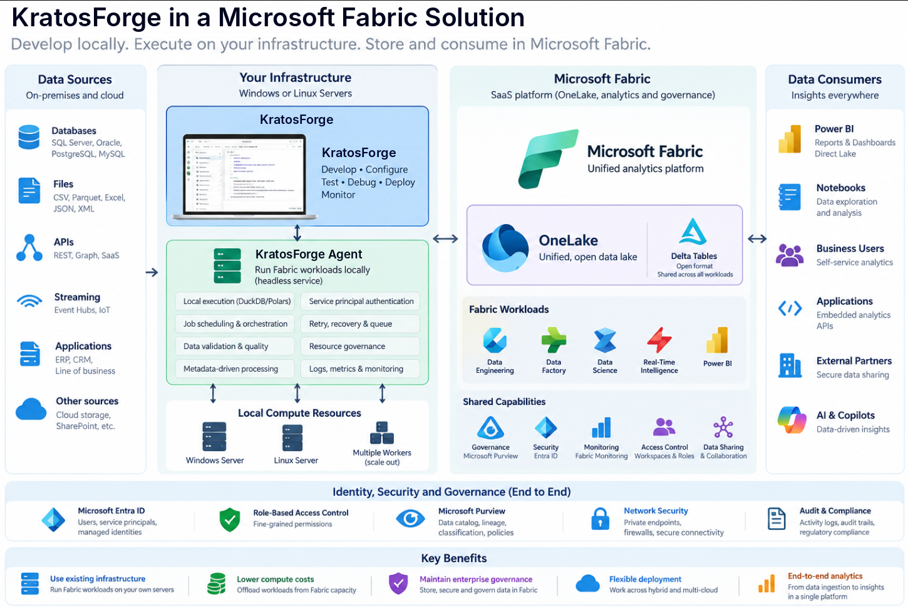

# KratosForge


Build and run your Microsoft Fabric data engineering on your own Windows PC: notebooks, Spark SQL, jobs and a metadata-driven medallion framework. Results are written straight into OneLake as Delta tables. A run on this PC starts no Fabric job, which cuts Fabric CU use; its OneLake reads and writes still use capacity.



**Develop with KratosForge. Execute on your infrastructure. Store and consume in Microsoft Fabric.** Today the desktop app and a single-node [headless agent](docs/agent.md) are built. Why it exists: [Bringing the Power BI Model to Data Engineering](docs/why-kratosforge.md).

## Where it stands

- **New, and not yet checked end to end on a live Fabric tenant.** What talks only to your PC is tested on every build; features that talk to Fabric and haven't been tried on a tenant are marked **Preview** in the app. See [What is tested and what isn't](docs/README.md#what-is-tested-and-what-isnt).
- **The exe isn't code-signed yet,** so Windows SmartScreen warns the first time you start it.
- **`spark` on your PC is DuckDB's PySpark-style API, not Spark.** Of PySpark's 102 DataFrame methods, 70 work, 9 are accepted and do nothing on one PC (such as `cache` and `repartition`), 8 run only in Fabric and 15 aren't built yet. 14 of SparkSession's 17 work. The same notebook runs on real Spark in Fabric. The full list is in [Spark on this PC](docs/notebook-spark-on-this-pc.md).
- **Capacity savings shown in the app are estimates** (run time × the configured CUs), not measured bills. See [Cost evidence](docs/finops/cost-evidence.md).

## Quickstart: your first table in OneLake

You need Windows 10 or 11 and a work account with Fabric, plus a lakehouse you can write to. No Python, Spark or admin rights.

1. Download **kratosforge.exe** from the [Stable release](https://github.com/KratosDataGod/KratosForge/releases/tag/stable) and double-click it. If SmartScreen says "Windows protected your PC", choose **More info > Run anyway**.
2. The first start installs the local engine in a minute or two. Python comes with it.
3. Click **Sign in** on Home and pick your work account. There's no app registration.
4. **Create > Notebook**, then **Add data items** in the ribbon, select a lakehouse and **Attach**.
5. Run this cell with **Shift+Enter**:

   ```python
   spark.createDataFrame([(1, "hello")], ["id", "msg"]).write.mode("overwrite").saveAsTable("dbo.hello_kratosforge")
   ```

   The table is written on this PC first and uploaded in the background; the cell ends once it's in OneLake.
6. Open the lakehouse in Fabric (or the app's OneLake page) and you'll see `hello_kratosforge`.

Next: [Install](docs/install.md) has the details and what to do if Windows blocks the engine, and the [user guide](docs/user-guide.md) walks through the app.

## Limits worth knowing

- **Windows only** for the app. The [headless agent](docs/agent.md) also runs on Linux.
- **No installer.** It's a single exe that updates itself ([Updates](docs/install.md#updates)).
- **No V-Order from your PC.** Direct Lake reads V-Ordered tables faster, and only Fabric Spark writes them: [run the last cell on Fabric](docs/notebook-fabric-step.md).
- **Tables use a conservative Delta profile** (reader 1, writer 2, no deletion vectors or column mapping) so the SQL analytics endpoint and Direct Lake can read them.
- **Pipelines are Preview.** **Create > Pipeline** opens a Fabric pipeline and runs its control flow on your PC, with mocks for activities that only run in Fabric. It hasn't been compared with a run in Fabric yet ([Running pipelines on your PC](docs/orchestration/local-runs.md)). A Fabric pipeline asking the agent to run an environment is also Preview and not yet run on a live tenant ([Run from a Fabric pipeline](docs/agent.md#run-from-a-fabric-pipeline)).
- **Fabric Git integration and deployment pipelines are planned, not built** ([plan](docs/git-integration-plan.md)).
- **Preview features** are tagged in the app. **Settings > Preview features** hides them.

## How it works

- **Local compute:** notebooks run in a Python kernel on the PC, SQL runs in DuckDB, and Python transforms run in Polars.
- **Direct to OneLake:** delta-rs writes each table straight to the lakehouse and commits the Delta log only after the data files are written, so Fabric never sees a half-written version.
- **Fabric-safe tables:** every table is checked against the Delta profile above before it's written.
- **Signs in as you:** delegated sign-in through Microsoft's own Fabric sign-in, so the app only does what your Fabric access allows ([Permissions](docs/permissions.md)).
- **Headless agent:** the same engine runs unattended on a server as a service principal or managed identity, with a job queue, retries and per-table write leases.

How the pieces fit together: [Architecture](docs/architecture.md).

## Documentation

**Read the docs at [kratosdatagod.github.io/kratosforge](https://kratosdatagod.github.io/kratosforge/)**, or start at the [documentation home](docs/README.md), which says which guide to read for what you're doing.

| Guide | For |
| --- | --- |
| [Install](docs/install.md) | Download, first start, updates and channels |
| [User guide](docs/user-guide.md) | Every page of the app |
| [Notebooks](docs/notebooks.md) | Writing and running notebooks on your PC, and publishing them to Fabric |
| [Metadata guide](docs/metadata-guide.md) | The metadata-driven medallion framework |
| [Enterprise install](docs/enterprise-install.md), [Permissions](docs/permissions.md), [Security](docs/security.md) | IT admins rolling it out |
| [Headless agent](docs/agent.md) | Running the engine on a server |
| [Contributing](CONTRIBUTING.md) | Building from source, tests and code signing |

Some files, folders and settings keep a legacy name so nothing breaks: [which ones and why](docs/kratosforge.md).

## Build from source

```powershell
git clone https://github.com/KratosDataGod/KratosForge
cd KratosForge\sidecar
python -m pip install -e ".[dev]"     # Python 3.12 or later
python -m pytest -q                   # every test runs without Fabric
```

Running the desktop app from source, the repository layout and the rules for changes are in [CONTRIBUTING.md](CONTRIBUTING.md).

## License

KratosForge's source code is licensed under the [Apache License 2.0](LICENSE). Copyright 2026 KratosBI LLC; see [NOTICE](NOTICE) for the third-party code it includes. The app you install also ships Microsoft's ODBC driver under Microsoft's own terms, which is why it will come with its own [end-user terms](docs/end-user-terms.md) (a draft, not in effect yet).
