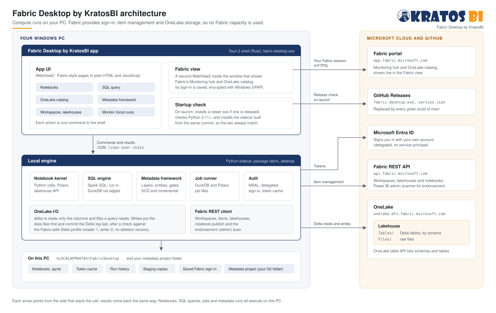

# Architecture

KratosForge does Microsoft Fabric data engineering work on your own Windows PC and writes the results straight into OneLake. Fabric is used for sign-in, for managing items and for storage. Notebooks, SQL queries, jobs and metadata runs all execute on the PC, so they start no Fabric job; their OneLake reads and writes still use capacity.

## The pieces

### KratosForge app (`app/`)

`kratosforge.exe` is a [Tauri 2](https://v2.tauri.app/) shell written in Rust. It holds two WebView2 views and starts the local engine.

| Part | What it does | Code |
| --- | --- | --- |
| **App UI** | The Fabric-style pages: Home, Create, Workspaces, OneLake catalog, Fabric, notebooks, SQL query, Metadata and Monitor. Plain HTML and JavaScript with no build step. `activity.js` holds the environment picker, the activity tray and plain-language errors. Each data action is one `rpc` command to the shell. | `app/ui/` |
| **Fabric view** | A second WebView2 laid over the page, showing Fabric's own portal from `app.fabric.microsoft.com`: full page on the **Fabric** page, where item links across the app open, and the Monitoring hub on **Monitor**. It has its own WebView2 profile that uses Windows single sign-on. Its sign-in cookies are saved every few seconds, encrypted with Windows DPAPI, and restored before the next launch's first page load. Only Fabric and Microsoft sign-in pages open in it (the host list is in [security](security.md)); other links open in the default browser. | `fabric_view_show`, `mod signin` in `app/src-tauri/src/main.rs` |
| **Startup check** | Before the engine starts: if GitHub Releases has a newer build, it downloads it, checks the file is that build, swaps the exe and restarts. It then checks Python 3.12 or later, and installs the sidecar from the commit the exe was built from, so the exe and the engine always match. | `check_components`, `app/src-tauri/src/updater.py` |

### Local engine (`sidecar/`)

The Python package `fabric_desktop`, run by the shell as `python -m fabric_desktop.server`. It reads one JSON request per line on stdin and writes one JSON response per line on stdout. `Service` in `service.py` lists every method the UI can call.

| Module | What it does |
| --- | --- |
| **Notebook kernel** (`notebook.py`, `lakehouse.py`) | Runs notebook cells in one Python namespace. The `lakehouse` module is the notebook API: `read_csv`, `read_parquet` and `read_json` for `Files/`, plus `read_table`, `write_table` and `sql`. |
| **SQL engine** (`sql.py`, `sql_dialects.py`, `sql_format.py`) | Takes Spark SQL, as Fabric's SQL query tab does. sqlglot translates each statement to DuckDB SQL. Every table the query names becomes a DuckDB view over that table's Delta dataset in OneLake. `sql_dialects.py` lists the dialects the SQL page edits (Spark SQL, Fabric Warehouse, SQL analytics endpoint and SQL database T-SQL, DuckDB) and which run on this PC; `sql_format.py` formats SQL with sqlglot and refuses any change beyond layout and case. The page is `app/ui/query.js` and its editor is `app/ui/sqleditor.js` (CodeMirror 6), with completion from a metadata provider so Warehouse metadata can plug in later. |
| **SQL compatibility** (`sqlcompat/`) | Checks SQL against a Fabric engine's documented rules without running it: profiles per engine, versioned rules with sources and confidence, and an analyzer that reports findings with positions. Shown as editor diagnostics and the Compatibility panel. See [sql-compatibility.md](sql-compatibility.md). |
| **SQL execution** (`sql_exec.py`, `sql_worker.py`, `sql_policy.py`) | The SQL page's managed runs: each query is classified (read, session change, lakehouse write, outside change) before it runs, then runs in a process of its own with DuckDB's memory limit, a temp folder and external access locked off. A queue caps how many run at once; Stop and the time limit end only that process. The result streams into an Arrow IPC snapshot that pages and exports (CSV, Parquet) read by batch, so large results are never held in memory. One audit line per run, without the SQL. See [sql-execution.md](sql-execution.md). |
| **Metadata framework** (`meta/`, `meta_service.py`) | Layers, entities, the four gates, SCD Type 1 and 2, incremental loads, quarantine and promotion from Dev to Test to Prod. See the README. |
| **Fabric hand-off** (`cloud_service.py`, `fabric_run.py`, `maintenance.py`, `semantic.py`, `profiling.py`) | The work that deliberately uses Fabric capacity: Run in Fabric and schedules for published notebooks (with the setup cell that makes `fabric_desktop.lakehouse` work in a Fabric Python notebook), table health and Fabric's table maintenance job (OPTIMIZE with V-Order, VACUUM), and a Direct Lake semantic model written as TMDL. Profiling runs locally and suggests `[[clean]]` and `[[check]]` blocks. |
| **Fabric compute** (`fabric_compute.py`) | Metadata runs for an environment set to run on Fabric: uploads the engine and project to `LH_Meta/Files/_fabric_desktop/current`, publishes the runner notebook `nb_fabric_desktop_runner`, starts or schedules it with Fabric's job scheduler, and reads its results file back. Inside Fabric, `run_bundle` runs the same `Engine` against the same OneLake tables. |
| **Git** (`git/`, `git_service.py`) | Source control: runs the person's own `git` with prompts off, literal paths and only the https, ssh and file protocols. `repo.py` reads status, diffs, branches and history and stages and commits; `ops.py` runs clone, fetch, pull and push in the background so the engine keeps answering; `secrets.py` scans staged files before a commit and removes credentials from every message. Sign-in is Git Credential Manager or the SSH agent; the engine never sees a password or token. |
| **Local data projects** (`localdata/`, `localdata_service.py`) | A persistent DuckDB database per project on the PC. Registered folders of CSV, JSON, Parquet and Delta files become views (`discovery.py` names them), queried with limits, time-outs and cancel. No sign-in. See [local-data.md](local-data.md). |
| **Job runner** (`jobs.py`, `publish.py`) | TOML job files that run DuckDB SQL or a Polars script and publish the result. |
| **Auth** (`auth.py`) | MSAL public-client sign-in as you (delegated, no service principal). Tokens for Fabric, Azure Storage and, when consented, the Power BI admin API. The token cache is on the PC. |
| **OneLake I/O** (`onelake.py`, `publish.py`, `delta_profile.py`) | Builds OneLake paths, lists files and tables, and reads and writes Delta with delta-rs. |
| **Fabric REST client** (`fabric_api.py`) | Workspaces, items, lakehouses, notebook publish, job instances and schedules, table maintenance, semantic models, SQL endpoint metadata refresh, and the admin workspace scan used for endorsement. It and the OneLake, Power BI and platform clients share one pooled session from `http_session.py`; reads retry through `retrying.py`, writes are sent once, except platform changes: those carry a call id through UDF_Platform's `call_once`, so a retried change is applied once and its first answer is replayed. Telemetry, the Teams webhook and the managed identity token client keep their own connections. |
| **Workloads** (`workloads/`, `workload_service.py`) | One inventory of what runs where: metadata entities per environment, notebooks on this PC and their Fabric items, and pipelines, notebooks and Spark jobs in the workspaces the app works in. Reads existing records only (run logs, `fabric_runs.jsonl`, PC and Fabric schedules) and says how fresh each reading is. Ownership, links and actions taken from the app are kept in `workloads.sqlite`. |

### On this PC

`%LOCALAPPDATA%\FabricDesktop` holds:
- notebooks (`notebooks\*.ipynb`)
- the MSAL token cache
- run history, and the jobs this app started in Fabric (`fabric_runs.jsonl`)
- workload owners, links to Fabric items and actions taken from the app (`workloads.sqlite`)
- the local staging table of each write (its schema only, no rows)
- catalog favorites
- the list of repositories opened in Source control (`git_repos.json`; the repositories themselves stay where you put them)
- the Fabric view's profile and its saved, encrypted sign-in
- `sidecar.log`

A metadata project is a folder you choose and keep in Git.

### Microsoft cloud and GitHub

| Service | Used for |
| --- | --- |
| Microsoft Entra ID | Signing you in |
| Fabric REST API (`api.fabric.microsoft.com`) | Listing and creating workspaces, lakehouses and notebooks |
| OneLake (`onelake.dfs.fabric.microsoft.com`) | `Tables/` (Delta) and `Files/` in each lakehouse. The OneLake table API lists schemas and tables. |
| Fabric portal (`app.fabric.microsoft.com`) | The pages shown in the Fabric view |
| GitHub Releases | The `latest` release: `kratosforge.exe` (also published as `fabric-desktop.exe` for builds before the name changed) and `version.json`, replaced by every green build of `main` |

## How a request flows

1. You click something in the app, for example **Run** on a SQL query.
2. The UI calls `invoke("rpc", {method: "run_sql", params})`. The shell writes it to the sidecar as one JSON line.
3. The sidecar attaches the lakehouse and translates the SQL. It opens each named table from OneLake with a storage token for your account, and DuckDB runs the query on the PC.
4. The result goes back as one JSON line. The shell returns it to the UI, which draws the grid.

Every other action follows the same path. Only the work in step 3 changes.

Several calls can be on the pipe at once. Each request carries an id, and the shell hands each reply only to the call with that id; a late reply nobody waits for is dropped. The sidecar runs the quick calls (the ones the shell gives a 60-second limit, such as polling a cell, opening a notebook and the SQL page's paging) in their own lane, so a long run, publish or sign-in doesn't hold them up. Every other call runs one at a time in the order it arrives. Saving, creating and renaming a notebook stay in that order with publish and delete, so a publish that waited can never write older cells over a newer save; while a long call runs, a save waits for it.

## Writing to OneLake

`lakehouse.write_table`, **Save as table**, jobs and metadata runs all write the same way:

1. An empty local staging Delta table with the result's schema is written first, since the schema alone decides the table's protocol, and deleted once checked. It is checked against the Fabric-safe Delta profile before anything leaves the PC: reader version 1, writer version 2, no deletion vectors, no column mapping and classic checkpoints.
2. delta-rs writes the Parquet data files to `Tables/<schema>/<table>`, or `Tables/<table>` in a lakehouse without schemas. It then commits the Delta log in one atomic step, so Fabric never sees a half-written version.
3. The written table is checked against the profile again, and the write is added to the run history shown in **Monitor**.

On a home or office line the upload is nearly all of a write's time: delta-rs already sends 5 MB blocks several at a time, so OneLake takes the bytes at the line's upload speed (about 4.5 MB/s on a 40 Mbps line). So notebooks on this PC make the upload do less and overlap it with the work:

- **Write here, then upload** (the default; `onelake_writes`). `write_table` keeps the table on this PC and returns at once, with the row count. A background queue uploads it while the cell goes on, so a cell computing the next table overlaps the previous one's upload, and different tables upload side by side (three at a time). One table's writes still commit in the order the cell made them. The cell ends only when its writes are in OneLake, and a write that fails fails the cell that made it, naming the table. The failure shows at the cell's end, so the rest of the cell has already run by then (a later write to the same table isn't made); with **Straight to OneLake** the cell stops at the failed write instead. A read of a table in the same cell waits for that cell's own writes first. Tables waiting in memory are capped at a quarter of the PC's memory; past that, `write_table` waits.
- **Straight to OneLake.** Each `write_table` returns once its write is committed. For a fast upload line there's little to overlap, and a script that prints right after each write sees the committed version. Each notebook chooses under **Runs on > Table writes to OneLake**, kept in the notebook file; **Same as Settings** follows **Settings > Advanced > OneLake writes**. Scripts, jobs and Fabric runs always write straight through.
- **A stream is one commit.** `write_table` also takes a stream of batches: a `RecordBatchReader`, DuckDB's `fetch_record_batch`, or any iterable of tables. It goes to a spill file on this PC's disk (`staging/_writes`, removed when the upload ends, whether it succeeded, failed or was cancelled; one left by an engine ended mid-upload is removed a day later), never all in memory, and commits once. Before, a big table written in slices paid a commit's round trips for every slice.
- **Zstandard compression** (`onelake_compression`). The Parquet files are zstd level 3: on TPC-H about 26% fewer bytes than Snappy for the same encoding time. Fabric's Spark and the SQL analytics endpoint read them (checked with a TPC-H table in a lakehouse). Direct Lake reading zstd files written from outside hasn't been checked yet; if a report you use can't read them, choose Snappy.
- **A slow line finishes its uploads** (issue #785). Each data file goes up as 5 MB parts, at most 4 at a time per file, with up to 256 MB of files in flight per write (`DELTARS_MAX_CONCURRENCY_TASKS`, `DELTARS_MAX_IN_FLIGHT_UPLOAD_BYTES`; a value set in the environment wins). Each part may take 10 minutes and its retries 30 minutes, where object_store allows 30 seconds and 3 minutes, so a part that shares a 5 MB/s line with many others finishes instead of being cut off and sent again. If a data file's upload still fails on a dropped connection, a timeout or a 5xx, the table is written again, up to 3 times, 15 then 30 seconds apart: nothing of it was committed, so that's safe. A failure writing the Delta log isn't tried again, since the commit may have gone in.
- **Unchanged tables upload nothing** (`onelake_skip_unchanged`). Each overwrite keeps a fingerprint of its rows (count, sum and XOR of a hash of every row, with the column names and types) in its Delta commit, under `kratosforge.rows`. When the table's newest commit is an overwrite with the same fingerprint, a rewrite of the same rows, in any order, writes nothing and says "unchanged": the table keeps its Delta version, with no new commit. Any other commit since (an append, Fabric's own write) means the rows are written again.

Fabric registers a new table written from outside on its own schedule. Until then it can show under **Unidentified**, and refreshing the lakehouse in Fabric picks it up.

## Sign-in and security

- The app signs in as you through Entra ID. It has no service principal and no stored secret. Your access in Fabric is exactly your account's access.
- Tokens stay in the MSAL cache in your Windows profile.
- The Fabric view's sign-in cookies are encrypted with DPAPI, so only your Windows account on this PC can read them. Delete `fabric-view-signin.bin` to forget them.
- Git sign-in is Git Credential Manager or the SSH agent. The app never asks for or keeps a Git password or token, refuses addresses that carry one, and removes credentials from Git's messages before showing or logging them.
- The sidecar only listens on stdin and stdout. It opens no network port.

## Updates

Every push to `main` runs CI on Windows: sidecar tests, a check of a regular package install, and the exe build. When it is green, the `latest` GitHub release is replaced. At the next launch the app sees a newer commit in that release, updates itself, and installs the matching sidecar.

## Headless agent

The same engine also runs without the app, as `fabric-desktop agent run` on a Windows or Linux server. The agent adds a durable SQLite job queue, schedules, retries, per-table write leases in each environment's `LH_Meta`, and an app identity (service principal or managed identity) in place of your sign-in. See [agent.md](agent.md) and, for where it is headed, [enterprise-roadmap.md](enterprise-roadmap.md).
