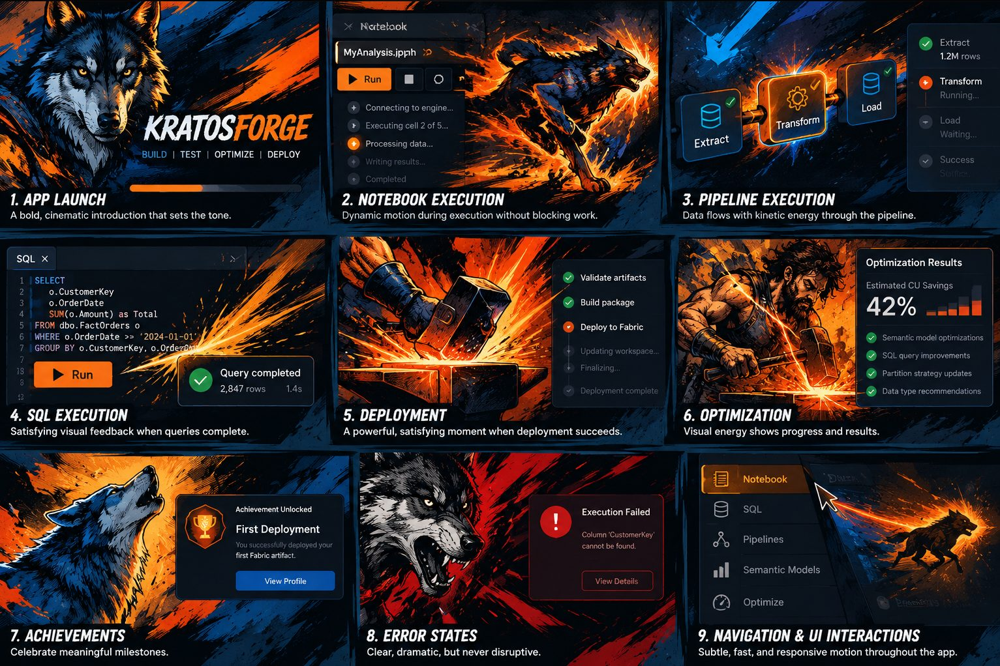

# KratosForge visual style guide: Forged Heroism

This is the authoritative visual specification for KratosForge. Every illustration, animation,
icon, onboarding screen and achievement that ships must pass the checks in
[Consistency checks](#consistency-checks) against this guide and against the
[canonical storyboard](#the-canonical-reference). It is owned by the Visual Experience Agent
(see [Who owns what](#who-owns-what)); changes to it go through Chris.

It sits above three documents that stay where they are and keep their jobs:

| Document | What it covers |
| --- | --- |
| [Animation style guide](../animation-style-guide.md) | The four motion tiers (Ember, Spark, Forge, Titan), timing and easing tokens, reduced motion, where tiers live in `motion.js` |
| [Motion and effects](../forge-animations.md) | Every effect that ships today, the four intensity levels, performance budgets, the developer API |
| [UI guidelines](../ui-guidelines.md) | Where a feature goes, the navigation budget, Preview labelling, UX review |

Companion files in this folder: the [asset manifest](assets.md), the
[wolf character sheet](wolf-character-sheet.md), the [animation event catalog](animation-events.md)
and the [examples](examples.md).

## The identity in one line

**Dark steel and navy, struck by forge orange.** Kratos the smith strikes, the wolf runs, the
forge glows, winter cools. Drawn like a premium graphic novel, moving like a modern fighting game,
in the way of an enterprise tool that never gets in your way.

## The canonical reference

The nine-panel storyboard is the approved creative direction. It lives at
`docs/design/reference/kratosforge-storyboard.png` (original, 1533 by 1022) with a web copy and
one JPEG per panel under `reference/panels/`. If you cannot see it, ask for it. Do not invent a
replacement from the text of this guide.

| Panel | Moment | What it establishes |
| --- | --- | --- |
| 1 | App launch | The calm wolf portrait beside the wordmark, the four phases BUILD, TEST, OPTIMIZE, DEPLOY, dark navy with a warm fire glow |
| 2 | Notebook execution | The wolf running through painted fire beside a real notebook, embers crossing into the UI, a progress line |
| 3 | Pipeline execution | Energy along the real pipeline graph, the wolf small and to the side |
| 4 | SQL execution | The calm wolf beside a real query card, sparks on completion, an orange ink splash behind the result |
| 5 | Deployment | Kratos the bearded smith at the anvil, hammer raised, mid-strike |
| 6 | Optimization | The hammer on the anvil, a controlled fountain of sparks |
| 7 | Achievements | The wolf howling, "Achievement Unlocked / First Deployment / View Profile" in heavy condensed italic |
| 8 | Error states | The wolf snarling in restrained red and orange beside a real "Execution Failed" panel |
| 9 | Navigation and UI | The running wolf as a streak beside the real left rail |

The grammar every panel shares: **painted art sits beside real UI, never over it.** The art is
cut by a diagonal or an ink edge, the UI stays legible, and the motion crosses between the two
(an ember drifts into the panel, a spark lands on the result card).

## The style: Forged Heroism

Three influences, weighted by priority. The percentages say what to reach for first when they
pull in different directions; they are not rendering proportions.

**40% heroic comic-book illustration.** Powerful, recognizable silhouettes. Bold black ink
outlines. Crosshatching and solid shadow shapes. Dramatic perspective and low or high camera
angles. Characters are illustrated, never photorealistic.

**35% painterly fantasy realism.** Visible brushwork and hand-painted texture. Cinematic light
with one hot source (the forge) and one cold source (steel, winter, the screen). Physical
materials: hammered steel, stone, smoke, fire, fur. Rich atmosphere behind the subject. It should
look handcrafted and premium, not generated.

**25% kinetic graphic energy.** Explosive brushstrokes, directional trails, ink and paint splashes,
distressed textures, bold diagonals. This is the fighting-game layer: it gives impact to the
moments that deserve it and is absent from the ones that do not.

What it is **not**: generic corporate illustration, a flat cartoon mascot, unrelated anime styles,
cyberpunk neon, photorealistic stock art, an AI character that looks different every time, glossy
mobile-game gloss, or a full-screen effect that nobody asked for.

## Colour

Existing brand assets (`docs/brand/`, `app/ui/styles.css`) are the authority where they differ
from this table. The CSS token column is what the UI uses today; the proposed hex values from the
directive are kept as the illustration palette for painted art.

### Primary

| Role | Hex | CSS token today | Use |
| --- | --- | --- | --- |
| Deep navy | `#1B3664` | `--accent` | Brand blue, primary actions, the wolf's shadow side |
| Forge orange | `#F8991C` | `--brand-orange` | Fire, sparks, the hot face of the hammer, the one accent on a dark panel |
| Near-black | `#0B1420` | (new: `--ink`) | Ink outlines, the darkest environment, letterbox |
| Steel blue | `#244A70` | (new: `--steel`) | Mid-tone of steel and fur, panel backgrounds under the navy |
| Ember orange | `#FF5B1F` | (new: `--ember-hot`) | The hottest core of a strike, used sparingly inside forge orange |
| Warm white | `#F3F5F7` | `--accent-soft` is close (`#e9eef7`) | Text on dark, highlights on steel, the cream of a title |

### Secondary

| Role | Hex | Use |
| --- | --- | --- |
| Charcoal | `#2A2F3A` | Smoke, soot, the anvil body |
| Graphite | `#595E6B` | Stone, cold steel edges, disabled art |
| Molten gold | `#FFD08A` | The brightest spark, the lit edge of the hammer face |
| Crimson, restrained | `#B10E1C` | Error states only, never more than a third of a panel, never animated as a celebration |
| Ice blue | `#A9C4EA` | Winter, waiting on Fabric, the wolf's eye highlight, the cold rim light |

The animation tiers' fire and winter ramps (`--fx-spark` to `--fx-ash`, `--fx-frost` to
`--fx-storm`) are defined in the [animation style guide](../animation-style-guide.md#colour) and are
derived from forge orange and deep navy. Meanings hold everywhere: **orange is work on this PC,
ice blue is Fabric or waiting, ash grey is failure, green is a fact and is never animated.**

The core relationship is dark steel and navy environments against powerful orange forge energy.
Do not introduce another palette into the application identity. A one-off illustration that needs
a new colour gets it as a secondary added to this table, in a pull request.

## The KratosForge wolf

The wolf is the signature character. One design, everywhere. The full sheet, with poses,
status and generation prompts, is [wolf-character-sheet.md](wolf-character-sheet.md).

- Powerful, intelligent, determined. Anatomically believable, heroically stylized.
- Dark blue-black fur with controlled steel-blue highlights; ink lines in the fur with painted light
  on top.
- Amber-orange eyes. Forge light on the muzzle and chest when the forge is in the scene.
- A silhouette you can recognize at 32 px (the emblem) and at full bleed.
- Expressive, never cartoonish: it does not grin, wink or wear anything.

Reusable reference poses: portrait, running, howling, emerging from forge energy, celebrating,
warning, minimal silhouette, monochrome ink. The emblem in `docs/brand/` is the current approved
silhouette and the storyboard holds the approved painted portrait, running, howling and snarling
poses. Every new wolf image is checked against these; a wolf that looks like a different animal
is rejected, however good it is on its own.

## Kratos and the forge

Kratos is a bearded blacksmith at the anvil, not a fighter. Bare arms, a leather apron, a war
hammer with a navy steel head and a glowing face. He appears at the moments of making: deployment,
optimization, a release. He never appears in error states.

The forge language, used so the pieces read as one world:

- **Hammer and anvil**: creation, commitment, "this is done".
- **Molten orange energy and sparks**: work happening here, on this machine.
- **Forged steel textures**: the environment, panel edges, the material of the app.
- **Sweeping ink strokes and directional brush-painted movement**: speed, transition, the wolf's
  path.
- **Strong light-to-dark contrast**: one hot source against a dark ground.

The art reinforces the meaning of the action. A deployment shows a compact hammer impact, then a
short burst of sparks, then the success indicator. A notebook run shows the restrained running
wolf beside the real execution status. An error shows a still, cooling treatment, never a
celebration.

## Typography

| Role | Face | Notes |
| --- | --- | --- |
| Display (titles, achievement names, phase words) | Barlow Condensed, black italic (900) and extra-bold italic (800), uppercase | The storyboard's heavy condensed italic. Ink outline when it sits on art. Falls back to Arial Narrow, then Impact. |
| Taglines and eyebrows | Source Sans 3 semibold, letter-spaced uppercase | "ACHIEVEMENT UNLOCKED", "FIRST BLOOD ON THE ANVIL" |
| Application text | The app's existing stack (Segoe UI, system-ui) | Unchanged. Display type never replaces UI text. |

Display type is for the art layer and for celebration cards. It does not appear in forms,
tables, errors or settings.

## Animation standards

Every decorative animation, at every tier:

- **Never interrupts a workflow.** Nothing waits for an animation to finish. Execution,
  navigation and saving start on the click, not after the effect.
- **Never blocks controls, editors or data.** `pointer-events: none`; drawn beside the UI or in a
  region that holds no control.
- **Never steals keyboard focus.** Focus stays where the person put it; a Titan ends on any key
  without consuming it further.
- **Never obscures an error or a diagnostic.** The error is on screen from the first frame. Error
  treatments are restrained red and orange and never celebratory.
- **Never creates excessive movement.** At most three effects at once; the tier table caps size,
  length and frequency.
- **Never requires cloud execution.** Everything draws locally from local state.
- **Always has a reduced-motion alternative.** A still, a fade, or nothing; see the
  [animation style guide](../animation-style-guide.md#reduced-motion-and-fallbacks).
- **Always respects the person's setting.** Off means off, including launch and achievements.

Expressive comic-book treatment is for significant moments. Everyday interactions get subtle,
functional motion. The app must be professional and fully usable with every decorative animation
disabled.

### Motion primitives

The primitives, their timing and easing tokens, and the tier each belongs to are defined once in
the [animation style guide](../animation-style-guide.md). In short:

| Primitive | Tier | What it is |
| --- | --- | --- |
| Breathe | Ember | A slow, symmetrical glow or scale while a state lasts |
| Drift | Ember | One ember or frost mote rising, 2 s, then gone |
| Spark burst | Spark | Two to fourteen streaks thrown up and away from a label |
| Ink splash | Spark, Forge | A paint splat that pops in with back-ease and holds, orange for success, ice for Fabric, crimson for failure |
| Streak | Spark | A directional light run along a rail or a lane |
| Strike | Forge | Anticipation, heavy landing, release; the anvil |
| Wipe | Forge, Titan | A slanted edge revealing a painted panel |
| Impact frame | Titan | One or two frames of inverted high-contrast speed lines |
| Dome | Titan | The expanding half-ellipse shockwave with a hot rim |
| Camera | Titan | Creep, hit and whip-zoom applied to the whole scene; shake decays at 0.86 per frame |
| Title slam | Titan | Display type scaling in from 3x on an expo ease, with an ink outline and a short chromatic split |

### Accessibility

- Honour `prefers-reduced-motion` and the in-app level; both are read on every play.
- Every effect is `aria-hidden`; results are announced by the status text, not the effect.
- Colour never carries meaning alone (orange on navy is about 2.2:1); the word is always there.
- Flashes: no more than two impact frames per sequence, never within 50 ms of each other, never a
  full-window white for longer than 260 ms, and never at all below the Expressive level.
- A Titan ends on any key or click and never traps focus or scroll.

### Performance

- Transform and opacity only in CSS; canvas for Titan only, cleared and released when it ends.
- Budget: a Forge effect under 1.2 s, a Titan under 7 s, 60 fps on a 2020 business laptop with
  the window at 1920 by 1080, and no frame over 16 ms outside the impact frames.
- Painted art ships as WebP under 150 KB per piece for in-app use, with the original PNG kept in
  `docs/design/` or the asset store named in the [manifest](assets.md).
- Nothing animates while the window is in the background or the tab is hidden.
- Titan art and fonts are decoded before the first frame; if they are not ready in 400 ms, the
  reduced-motion still plays instead.

## Animation categories

The nine categories map onto the four tiers. The event names are the ones `motion.js` fires
today; the full catalog with regions, lengths and fallbacks is
[animation-events.md](animation-events.md).

| Category | Tier | Treatment |
| --- | --- | --- |
| Application launch | Forge, once per start | The wolf portrait beside the wordmark, the fire breathes, the four phase words land, the bar fills with real engine readiness. Never delays readiness; at Minimal it is a fade. |
| Notebook execution | Ember while running, Spark per cell, Forge for a long run | Running energy on the status, the wolf on a real progress track, sparks on a cell's success |
| SQL execution | Spark | Directional sparks and an orange splash on the result card, once |
| Pipeline execution | Ember along the real graph, Spark per activity, Forge on success | Energy flows only along links whose activity is actually running |
| Deployment | Forge | A compact anvil strike and sparks on confirmed success |
| Optimization | Forge | Controlled energy with the validated improvement; savings are labelled estimated or measured |
| Achievements | Forge for a badge, Titan for a milestone | The howling wolf and a cinematic reveal, only for meaningful milestones, only at Expressive with celebrations on |
| Errors | Spark, restrained | The snarling wolf still, the panel in crimson and orange, a single settle; never a celebration or a shake |
| Navigation | Spark | A short directional streak along the rail and a subtle comic accent; 0.5 s or less |

Each animation is event-driven (it reports a real state change through `forgeEvent`), interruptible
and bounded to its region.

## Consistency checks

Every new illustration, animation or branded element answers all eight before it merges:

1. Does it look like it belongs in the nine-panel storyboard?
2. Does it preserve the established wolf design?
3. Does it use the approved palette, with meanings intact?
4. Does it combine heroic illustration, painterly craft and kinetic energy in the right measure
   for its moment?
5. Does it feel premium rather than generic?
6. Does it support the meaning of the interaction?
7. Does it preserve developer productivity (the standards above)?
8. Is it consistent with existing KratosForge components and tiers?

A "no" on 1, 2, 3 or 7 is a rejection. A "no" elsewhere is a finding with a required change. The
reviewer records the answers in the PR using the Visual identity line of the pull request
template, and the Release Manager's usability review carries gate UG-8 (see
[release gates](../ux/release-review.md)).

## Generating artwork

Use this instruction first, then add the subject:

> Create original premium graphic-novel-inspired artwork for KratosForge, combining heroic ink
> illustration, painterly fantasy realism, and kinetic combat-inspired motion graphics. Use powerful
> silhouettes, dramatic crosshatching, expressive brushwork, textured dark navy environments,
> steel-blue shadows, molten-orange highlights, dynamic diagonal compositions, and restrained sparks
> and energy trails. Maintain consistent wolf character design and industrial forge imagery. The
> result should feel handcrafted, cinematic, powerful, and visually connected to the approved
> KratosForge reference storyboard.

Then the subject: which pose from the [wolf sheet](wolf-character-sheet.md) or which forge moment,
the framing (full bleed, half panel, 1:1 portrait), the background (transparent, or flat
`#0B1420` to key), and the minimum size (2000 px on the long edge).

Always attach the canonical storyboard and the relevant character-sheet image to a generator that
accepts image references. A text prompt alone does not keep the wolf the same wolf.

Record every generated piece in the [asset manifest](assets.md) with its source, prompt, licence and
approved variants before it is used in the app.

## Who owns what

| Role | Responsibility |
| --- | --- |
| Visual Experience Agent | Owns this guide, the manifest and the character sheet. Reviews every PR that adds or changes illustration, animation, onboarding or achievement visuals against the eight checks. |
| Simplicity Oversight Agent | Independently verifies that an artistic change does not reduce usability: the animation standards, the navigation budget and the UX gates in `docs/ux/`. |
| Release Manager | Confirms visual changes introduce no regression (tests in `app/tests/ui.test.cjs` and the browser motion tests) before a Preview or Stable build. |
| Chris | Approves changes to the storyboard, the wolf design and this guide. |

## Permanent directive

KratosForge has one recognizable visual identity across every feature, animation, illustration and
developer experience. The storyboard and this guide are the source of truth. Future visual work
extends this identity; it does not reinvent it. The target is an application with the artistic
impact of a premium graphic novel, the craftsmanship of illustrated fantasy, the kinetic excitement
of a modern fighting game, and the usability and precision of an enterprise development
environment. Unmistakable, memorable and enjoyable, without ever compromising the developer's work.
