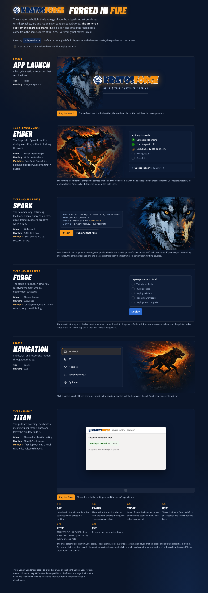
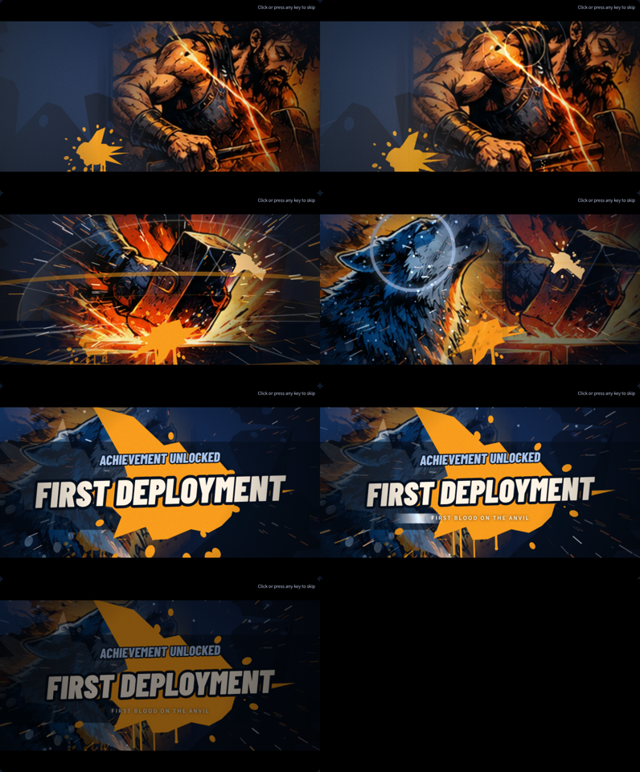

# Examples: approved and rejected

Working examples of the identity, and the styles that are turned away. The playable sample page
is `docs/design/examples/forge-motion-samples.html`: open it in any browser, no build step; it
contains the art as data so it works offline. Its art is cropped from the storyboard as a stand-in
until full-size pieces exist (see the [asset manifest](assets.md)); the motion, camera, splashes
and type are final.

## Notebook execution (Ember and Spark)

The wolf runs through painted fire on the left; the real notebook status list is on the right.
The running step's dot breathes orange, the painted fire breathes with it, and single embers rise
out of the art into the panel. A step waiting on Fabric is frost blue. Everything stops the moment
the state stops.

Why it passes: painted art beside real UI (check 1), the storyboard wolf (2), orange for work here
and ice for Fabric (3), restrained motion for an everyday action (4, 7).

## Deployment (Forge)

The deploy steps tick through in the real panel. On the last one the hammer comes down into the
panel: one flash, an orange ink splash, sparks thrown up and away, and the painted strike holds as
the still. In the app this is the Anvil Strike at Forge scale, bounded to the status region.

Why it passes: the hammer means "committed" (6), the success word is there from the first frame
(7), one region, under 1.2 s (8).

## Achievement (Titan)

The milestone sequence, about 6.5 s, skippable by any key or click, Expressive only, with
celebrations on:

| Time | Beat | What happens |
| --- | --- | --- |
| 0.0 s | Cut | Letterbox bars, the window dims, navy ink blooms across the desktop |
| 0.6 s | Kratos | The smith at the anvil pushes in from the right; embers drift; the camera creeps in |
| 1.9 s | Wind-up | Light gathers over the anvil, speed lines close in |
| 2.2 s | Strike | Two impact frames; the hammer panel slams down; dome, spark fountain, orange splash, camera hit |
| 3.2 s | Howl | The wolf wipes in from the left on an ice splash and throws its head back; frost rises |
| 3.9 s | Title | ACHIEVEMENT UNLOCKED, then FIRST DEPLOYMENT slams in on an orange splat; the tagline sweeps |
| 5.8 s | Out | To black, then back to the desktop |

Why it passes: it is the storyboard's panels 5, 6 and 7 in sequence (1, 2), the three influences
at full weight for the one moment that earns it (4, 5), and it never plays below Expressive, never
without celebrations on, never twice in ten minutes, and ends on any input (7).

## Error state (restrained)

The snarling wolf still replaces the calm one; the panel shows "Execution Failed" in crimson from
the first frame; the card settles once. No splash, no shake, no sparks.

## Rejected

| Looks like | Why it is turned away |
| --- | --- |
| A flat, friendly cartoon wolf mascot with a big smile | Breaks the character (check 2) and the premium bar (5) |
| A different-looking wolf each time, as generators tend to produce without references | Check 2; attach the storyboard and the character sheet |
| Neon cyan and magenta cyberpunk glow | Not the palette (3); the only cold colour is ice blue from the navy |
| Photorealistic stock photography of a wolf or a forge | Not illustrated (the 40% and 35%) |
| Unrelated anime styling (big eyes, cel-shaded chibi) | The Akira-era impact frames and speed lines are part of the kinetic layer; anime character design is not |
| Glossy mobile-game gold coins, confetti, star bursts | Not the material language (forge, steel, ink) |
| A full-screen effect on an everyday action | Tier rule: the whole window is Titan, Titan is for milestones only |
| A red celebration | Crimson is for errors, and errors never celebrate |
| A fighter in a Street Fighter stance with health bars | Superseded: Kratos is a smith at the anvil; no HUD, rounds or timer |
