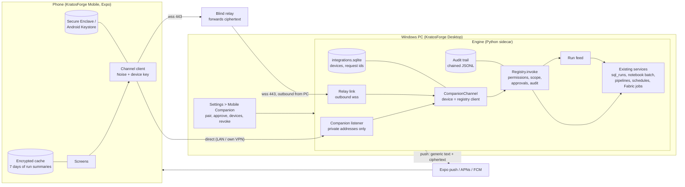
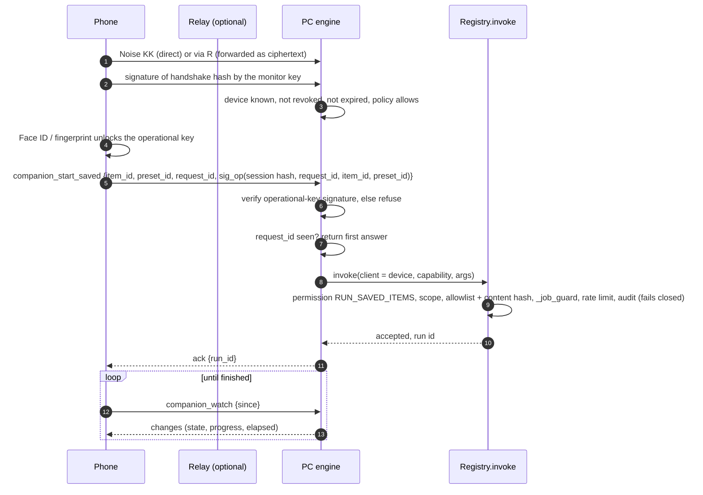

# Mobile companion: architecture decisions

Decisions for the [mobile companion plan](mobile-companion-plan.md). **Proposed** means it waits for
Chris; nothing here is built. Each says what, why, what was rejected and what would change it.

## Components



## MC-ADR-001 Hybrid connectivity, direct first

**Proposed.** Phone and PC talk over the same end-to-end channel either directly (local network or
the person's own VPN) or through a blind relay. P1 ships direct only; P2 adds the relay.

Why: weighted score 76 vs 73 (direct), 70 (relay), 57 (P2P) in the plan, section 2. Direct is free
and works offline; the relay is the only path that works on enterprise networks and away from home.

Rejected: relay-only (costs money for traffic that never needed to leave the room, fails with no
internet); WebRTC P2P (needs signaling and TURN anyway, unreliable on corporate networks, large
native dependency); a port forward or UPnP on the person's router (exposes the PC to the internet).

Would change if: the PoC shows Windows Firewall or Wi-Fi isolation blocks direct on most of the
PCs tried, in which case P1 and P2 merge and the relay ships first.

## MC-ADR-002 One end-to-end channel: Noise, not TLS certificates

**Proposed.** All traffic between a phone and a PC is a Noise protocol session
(`Noise_XXpsk3_25519_ChaChaPoly_SHA256` to pair, `Noise_KK_25519_ChaChaPoly_SHA256` to reconnect),
carried as binary WebSocket frames. The pairing PSK is the QR's one-time secret. Each frame after the
handshake is AEAD-encrypted with a counter nonce; a repeated or out-of-order counter closes the
session.

Why: the same channel works over the LAN and through a relay, so the relay never needs to be trusted
and there's no weaker path. No certificates: a LAN PC can't get a publicly trusted one, and
self-signed certificate pinning is hard to do from Expo. Noise is small, specified, and has public
test vectors. `cryptography` (already a dependency) has every primitive on the PC; `@noble/curves`,
`@noble/ciphers` and `@noble/hashes` (audited, no dependencies) on the phone.

Rejected: TLS with self-signed pinned certificates (needs native TLS hooks on the phone, and a second
layer anyway for the relay); bearer tokens over TLS like the VS Code pairing (a copied token works from
anywhere, so the phone's key must be what proves the device).

Release-blocking: whichever implementation is used passes the published Noise test vectors and an
interop test against a reference implementation. A vetted library is preferred over our own state
machine if it passes both.

Would change if: Expo adds first-class client certificates.

## MC-ADR-003 Device identity is a hardware-bound key, approved on the PC

**Proposed.** At pairing the phone makes two P-256 signing keys in the Secure Enclave or Android
Keystore (StrongBox where present), neither exportable, plus an X25519 Noise static key kept in the
encrypted store. The **monitor key** (no user presence) signs the Noise static key at pairing and
each session's handshake hash at reconnect. The **operational key** requires user presence on every
use (iOS `.userPresence`; Android authentication validity duration 0) and signs every operational
command over (session handshake hash, `request_id`, `item_id`, `preset_id`); the PC verifies that
signature before `invoke`, so presence is proven to the PC, not only to the phone. The PC stores both public keys with the device record. Approval happens
only on the PC, after the person matches a 6-digit code derived from the handshake hash on both screens.

Why: a stolen file from the phone (backup, jailbreak) can't impersonate it without the hardware
key; the code match defeats a race by someone who photographed the QR.

PoC exception: Expo Go can't reach the Secure Enclave, so the PoC uses software keys only, behind a
developer flag that is off by default and never merged enabled, against `kf_tenant_test` only.
Hardware keys are release-blocking for P1 (MC-104).

## MC-ADR-004 The phone is a registry client, not a new API

**Proposed.** The companion channel is a third transport onto `Registry.invoke`, beside MCP and the
local HTTP API. Each paired phone is a row in the integrations store's `clients` table with
`kind = 'companion'`, its public keys, grants and optional workspace list. Only capabilities tagged
`companion=True` are visible on this channel.

Why: permissions, workspace scope, approvals, audit and policy already exist and are tested; a
separate API would duplicate them and drift. Every check made for an AI tool is made for a phone.

Rejected: a separate REST service for the phone; exposing the existing local HTTP API to the network.

## MC-ADR-005 A new permission: run saved items

**Proposed.** Add `RUN_SAVED_ITEMS` between `READ_DATA` and `WRITE_LOCAL_FILES`: "Start, cancel and
retry items you marked Allow from phone on this PC. Never sends code." The PC keeps a list of items
(notebook, SQL script, pipeline, local schedule, metadata environment) the person marked "Allow from
phone", each with optional saved parameter presets. A phone can only name an item and a preset by id.

Why: `EXECUTE_LOCAL_CODE` approves code per run at the PC, which is useless when the person is
away, and is far broader. Pre-approving named, unchanged items at the PC is the line the brief draws
between operational and sensitive.

Binding: the allowlist entry stores the item's content hash when it was marked. What is hashed, by
kind: notebook, the code cells' sources and the notebook's attached lakehouse; SQL script, the script
text and its target lakehouse; pipeline, the pipeline definition JSON; local schedule, the schedule
record and the hash of what it runs; metadata environment, the project's entity definitions and the
environment name; Fabric item, the definition fetched from Fabric that will actually run. Each
preset's parameter values are part of the hash. The phone never passes a parameter value, only a
preset id. If the item changed
since, the phone sees "Changed since you allowed it. Allow it again on the PC" and can't start it.
This is the same idea as approvals bound to argument hashes in `integrations/permissions.py`.

## MC-ADR-006 Run feed over existing status calls

**Proposed.** A read-only `RunFeed` in the engine that lists active and recent runs across SQL runs,
notebook batch, pipelines, proofs, side-by-side, local schedules, metadata runs and Fabric jobs
started from this app, with stable ids `kind:native_id`, state, timings, progress where the run type
reports it, and `can_cancel` from the run type's real capability. A cursor (`since`) gives changes
only. The desktop's own Monitor may adopt it later; nothing in the desktop changes for the phone.

Why: no single list exists today (assessment 1.2). Building it over the existing status calls
duplicates no business logic.

## MC-ADR-007 Blind relay, run by whoever Chris chooses

**Proposed.** A stateless WebSocket relay that pairs one PC socket with its authorized phone sockets
and forwards opaque frames. The PC authenticates by signing a relay challenge with its key; it tells
the relay which phone key hashes may connect; phones authenticate by signing with their device key.
Open-source in this repository (`relay/`), one container image, no database (rate counters in memory
or a shared pub/sub when scaled). Hosting options for Chris: none (VPN only), organization-hosted
(recommended), or KratosForge-hosted.

The relay must never: accept a command, store a frame, expose an API besides connect and forward,
or run any code from either end.

## MC-ADR-008 Organization policy keys

**Proposed.** New keys in `policy.json` and the ADMX template, read with `read_policy()`, failing
closed:

| Key | Default | Effect |
| --- | --- | --- |
| `companion` | person decides | `false`: no pairing, listener and relay link stay off, paired devices can't connect |
| `companion_max_permissions` | `["READ_METADATA", "RUN_SAVED_ITEMS"]` | Ceiling for any phone |
| `companion_direct` | allowed | `false`: no listener on this PC |
| `companion_relay_url` | none | The only relay this PC may use. **Loosening key**: a person's setting can't add one |
| `companion_push` | allowed | `false`: no notifications sent from this PC |
| `companion_pairing_days` | 90 | Pairings older than this must pair again |

`companion_relay_url` joins `LOOSENING` (same treatment as `sign_in_tenant`).

## MC-ADR-009 Phone app: Expo (React Native)

**Proposed.** See the plan, section 3: score 74, ahead of PWA and Tauri mobile at 67. PoC in Expo Go;
MVP as an Expo development build with one small native module for hardware keys. Fallback: Tauri 2
mobile if Expo's key module or push proves unworkable.

## QR pairing sequence

```mermaid
sequenceDiagram
  autonumber
  actor P as Person
  participant D as PC (KratosForge)
  participant M as Phone
  P->>D: Settings > Mobile Companion > Pair New Device
  D->>D: pairing id, 32-byte secret, 120 s expiry, single use
  D-->>P: QR: kfpair:1, PC key fingerprint, addresses, port, pairing id, secret, expiry
  P->>M: Scan QR
  M->>M: make hardware P-256 key + X25519 static key
  M->>D: Noise XXpsk3 (psk = secret, prologue = pairing id + fingerprint)
  D-->>M: PC static key (phone checks it matches the QR fingerprint)
  M->>D: phone static key, name, platform, signature by hardware key
  D->>D: secret burned on the first attempt, success or failure
  D-->>P: "Pixel 9 wants to connect. Code 482 913. Allow: Monitor only / Monitor and run allowed items"
  M-->>P: "Check the code on your PC: 482 913"
  P->>D: Approve (or Deny)
  D->>D: device record: keys, grants, created, expires; audit line
  D-->>M: approved, device id, PC id, grants (inside the channel)
  M-->>P: Home screen for this PC
```

## Reconnect and command flow


