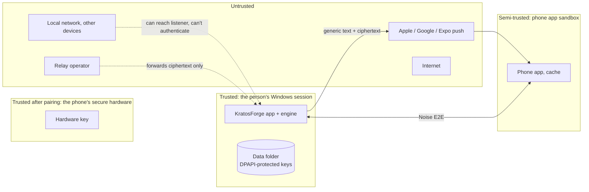

# Mobile companion: security design

Part of the [mobile companion plan](mobile-companion-plan.md). Status: **Proposed**, for Security QC
review before any code. Every item marked **RB** is release-blocking: P1 can't ship without it and a
test that proves it.

## 1. Goals and non-goals

- A phone can see and steer only what its owner allowed on the PC, as that Windows user, inside the
  existing KratosForge checks. It never gains a power the person at the PC doesn't have.
- The PC must not become a network server anyone can reach. Being near the PC, on its network, or
  running the relay must not be enough to do anything.
- Fabric, Databricks and Snowflake authorization is untouched: the phone never holds a provider
  token. Runs use the PC's existing sign-in exactly as if started at the PC.
- Not a goal: protecting against someone who already controls the PC's Windows account (they can
  already run anything).

## 2. Trust boundaries

New boundary 6 for `docs/security.md`: **Phones to engine.** Only while Mobile Companion is on and
policy allows it. The engine listens on private-range addresses only and/or keeps one outbound
connection to the organization's relay. Every connection must complete a Noise handshake with a
paired device key before any message is read.

## 3. Threat model (STRIDE)

| # | Threat | Where | Control | RB |
| --- | --- | --- | --- | --- |
| T1 | Someone on the same network connects to the listener | Listener | Listener runs only while Windows classifies the network as Private or Domain (never Public); Noise handshake first; unpaired keys get nothing; handshakes limited to 5 per IP a minute | RB |
| T2 | QR photographed or screen-shared | Pairing | Secret single-use, 120 s, burned on first attempt; PC shows device name and 6-digit code; approval only on the PC; at most 3 pairing requests waiting (as `editor_pairing.MAX_WAITING`) | RB |
| T3 | Replay of a pairing or session message | Channel | Noise ephemeral keys per session; AEAD counter nonces; out-of-order counter closes session | RB |
| T4 | Man in the middle on LAN or relay | Channel | Phone checks the PC's static key against the QR fingerprint; PC checks the phone's key against the device record; relay sees ciphertext | RB |
| T5 | Compromised relay | Relay | Can drop, delay or count frames; can't read, forge or replay. Relay has no command API. Its URL is a loosening policy key | RB |
| T6 | Stolen phone, unlocked, or a compromised app sandbox holding the session keys | Phone / Engine | Presence is proven to the PC, not just the phone: every operational command carries a signature by the phone's **operational key** (presence required on every use) over (session handshake hash, `request_id`, `item_id`, `preset_id`), checked by the PC before `invoke`; revoke from PC; "Disconnect all phones" | RB |
| T7 | Phone's files copied (backup, jailbreak) | Phone | Both hardware keys non-exportable; Keychain items `ThisDeviceOnly`; iOS operational key `.userPresence`; Android operational key `setUserAuthenticationRequired(true)` with validity duration 0 (every use) | RB |
| T8 | A paired phone tries more than it was granted | Engine | Registry permission check, `companion=True` allowlist, schemas with ids only, workspace scope, `companion_max_permissions` ceiling | RB |
| T9 | Command injection / arbitrary code | Engine | No capability on this channel takes code, SQL, paths, URLs or free text beyond display names; saved items bound by content hash | RB |
| T10 | Duplicate execution after a dropped connection | Engine | `request_id` idempotency table, 24 h; concurrent duplicates serialized per `request_id` | RB |
| T11 | Running into Test or Prod, or Prod writes | Engine | `_job_guard` unchanged; typed-name confirms can't be satisfied from the phone; Sensitive class not offered | RB |
| T12 | Secrets in run logs reaching the phone | Engine | Every string through `redact.secrets`; log tail capped (200 lines, 64 KB); no cell outputs, rows or images | RB |
| T13 | Sensitive data in notification previews | Push | Generic text only; detail as ciphertext for the device key; PC name optional | RB |
| T14 | Denial of service on the PC, pre-auth parser bugs | Listener / Relay link | No thread per connection before authentication (event loop or a small fixed pool); 5 s deadline for the HTTP upgrade and the first Noise message; header bytes capped (8 KB); global cap of 32 unauthenticated sockets beside the per-IP limit; 16 authenticated connections; 1 MiB frames max (64 KB normal); on the relay path every peer is the relay's IP, so limits there are per device key; the pre-auth parser is fuzzed | RB |
| T15 | DNS rebinding / browser page reaching the listener | Listener | WebSocket upgrade refused if `Origin` is present (phones send none); Noise handshake required | RB |
| T16 | Repudiation: "I didn't start that" | Audit | Every call audited with device id, path (direct / relay), request id; chain verifiable; Event Log anchor. **Fails closed:** an operational command whose audit line can't be written is refused, as Prod, approve and confirm actions already are | RB |
| T17 | Lost phone not noticed | Lifecycle | Pairings expire after `companion_pairing_days` (90) of no use; devices page shows last seen and path | |
| T18 | Malicious or tampered phone app | Supply chain | Store-signed builds only for P1; pinned dependency versions; `npm audit` and lockfile review in CI; no OTA code updates (Expo Updates off) | RB |
| T19 | Organization wants no phones | Policy | `companion: false` closes listener and relay link and refuses paired devices, read every check | RB |
| T20 | Another Windows user on a shared PC | Engine | Keys and device records in the user's own data folder (DPAPI); listener runs in the user's engine | |
| T20b | On a shared or Remote Desktop host, another Windows user's program on the LAN reaches this user's listener port | Listener | Same as T1: nothing without a paired device key; each user's keys and listener are their own | |
| T21 | Push token theft used to spam the phone | Push | Token stored only on the PC (DPAPI); never logged; rotate on re-pair | |
| T22 | Network exposure beyond the LAN; private addresses on untrusted Wi-Fi (cafe, hotel, office networks are RFC 1918 too) | Listener | Bind explicit interface addresses only (never `0.0.0.0` or `::`) whose Windows network category is Private or Domain; RFC 1918, link-local, ULA only; refuse public addresses; re-check on every address or network-profile change and close the listener on a change; `100.64.0.0/10` (Tailscale-style VPN) only on an adapter the person named in "Allow phones over this VPN", still Private or Domain; no UPnP or port mapping. Firewall: an inbound rule scoped to the Private profile and the KratosForge exe; when adding it needs elevation the app asks (IT can pre-create it in the MSI), never silently, and never disables or bypasses the firewall; without the rule, direct is unavailable and the app says so | RB |

## 4. Credential lifecycle

| Credential | Made | Stored | Lifetime | Rotated | Revoked |
| --- | --- | --- | --- | --- | --- |
| PC companion static key (X25519) | First time Mobile Companion is switched on | Data folder, DPAPI | Until reset | "Reset phone pairings" makes a new one; every phone must pair again | Same |
| PC relay key (Ed25519) | With the static key | DPAPI | Until reset | With the static key | Same |
| Pairing secret | Pair New Device | Engine memory only | 120 s, single use | Never | Burned at first use, on Cancel, on expiry |
| Phone monitor key (P-256, no presence) | Pairing | Secure Enclave / Keystore | Until unpair or app uninstall | Re-pair | Delete on PC |
| Phone operational key (P-256, presence on every use) | Pairing | Secure Enclave / Keystore | Same | Re-pair | Delete on PC |
| Phone Noise static key | Pairing | Keychain / Keystore-encrypted store, this device only | Same | Re-pair | Delete on PC |
| Session keys | Each connection | Memory | Until disconnect, at most 12 h, then rekey | Each connection | Close on revoke |
| Push token | Phone, sent inside the channel | PC, DPAPI | Until the platform changes it | Phone sends a new one when it changes | Deleted with the device |

No bearer token exists anywhere: possession of the phone's keys is the credential, so there is
nothing to rotate on a timer and nothing a log line could leak.

**Revocation is immediate (RB):** deleting a device on the PC closes its open sessions within 1 s
and every new handshake is refused with `device_revoked`; the relay is told to drop its key hash.

**Emergency disconnect (RB):** "Disconnect all phones" on Settings > Mobile Companion, and in the
activity tray menu, closes every session and pauses the listener and relay link until switched back
on. Pairings are kept, so this is reversible; "Remove all phones" deletes them.

**Lost phone:** remove it on the PC (or every PC it was paired with). If the PC is out of reach, the
pairing still expires; the phone's keys alone can't unlock anything once the PC removes it.

**Re-pairing after credential loss:** the phone app reinstalled or keys lost means pairing again; the
old device record shows "Not seen since ..." and can be removed. Pairing again never needs the old keys.

## 5. Authorization model

| Class | Examples | Permission | Extra checks |
| --- | --- | --- | --- |
| Read-only | Status, runs, history, metrics, savings | `READ_METADATA` | None |
| Operational | Start, cancel, retry allowed items | `RUN_SAVED_ITEMS` | Operational-key signature over (session hash, `request_id`, `item_id`, `preset_id`) verified by the PC, so biometric / passcode is proven per command; audit fails closed; item on the allowlist with unchanged content hash; `_job_guard`; rate limit; idempotency |
| Sensitive | Deploy, promote, restore, Prod writes, credential or connection changes, settings, pairings | Not offered on the companion channel | Future design needs Chris's decision; until then refused by the channel allowlist |

Default grant at pairing is **Monitor only**. "Monitor and run allowed items" must be picked on the PC.

## 6. Data exposure

- Sent to the phone: names of runs and items, states, timings, progress, redacted error messages and
  log tails, memory/CPU percentages, savings figures already shown in the app.
- Never sent: rows of data (unless a later story adds `READ_DATA` with Chris's go), cell outputs,
  code, connection strings, tokens, file paths outside display names.
- Phone cache: last 7 days of run summaries, encrypted at rest by the OS; cleared on unpair.

## 6a. Push and the PoC

- Push notifications are a new outbound path to a third party (Expo, Apple, Google). They are off
  until the person turns them on, separately from pairing, and the payload carries no PC name by
  default.
- The PoC uses a software key only, stays off by default behind a developer flag, is never merged
  enabled, and runs against nothing but `kf_tenant_test`. Its listener PR goes to Security QC like any
  non-loopback listener.

## 7. Supply chain

- PC: a vetted Noise library is preferred if it passes the published test vectors, an interop test
  against a reference implementation and the dependency review. Otherwise the state machine is
  written on `cryptography` (already a dependency) and must pass the same two (release-blocking),
  because it is then our own crypto code.
- Phone: Expo SDK pinned; `@noble/*` crypto; lockfile committed; CI runs `npm audit` with the
  repository's audit-exception rules; release builds signed by the store; Expo Updates (over-the-air
  JavaScript) off, so code on the phone only changes through a store release.
- Relay: one container image built in CI from this repository, minimal base image, no shell.

## 8. Release-blocking security controls (summary)

1. Listener and relay link off by default; policy `companion: false` honoured on every check.
2. Listener runs only on Private or Domain networks, binds explicit private interface addresses, re-checks on network changes, and uses a firewall rule scoped to the Private profile and the exe.
3. Noise handshake before any message; PC key fingerprint from the QR checked by the phone.
4. Pairing secret single-use, 120 s, burned on first attempt; approval on the PC with a code match.
5. Two hardware-bound, non-exportable phone keys; each operational command signed by the presence-required key and verified by the PC.
6. Companion channel exposes only `companion=True` capabilities; ids only, no code or paths.
7. `RUN_SAVED_ITEMS` limited to the PC's allowlist with content-hash binding.
8. `request_id` idempotency; rate limits (per device key on the relay path); bounded pre-auth surface (no thread per connection, 5 s deadlines, header and global caps); fuzzed pre-auth parser.
8a. Audit fails closed for operational commands.
8b. Noise implementation passes the published test vectors and an interop test against a reference implementation; a vetted library is preferred if it passes the same.
9. Every call audited with device and path; revocation and emergency disconnect within 1 s.
10. Generic notification previews; secrets redacted from every string.
11. Security QC review of every PR touching the listener, channel, pairing, relay or push.

## 9. Required tests

Unit and integration tests in CI (no network), each a story's acceptance:
operational command without a valid operational-key signature, signature over a different `request_id` or item, listener on a Public network, network profile change while listening, bind to `0.0.0.0` refused, slow upgrade and slow first Noise message cut at 5 s, global unauthenticated cap, per-device-key limit through the relay, audit write failure refuses the command, Noise interop against a reference implementation, pairing with wrong PSK, expired challenge, reused challenge, 4 waiting requests, wrong PC
fingerprint (MITM), handshake replay, reordered frame counter, revoked device mid-call and at
handshake, expired pairing, phone key swapped after pairing, duplicate and concurrent `request_id`,
connection dropped between accept and ack, oversize and malformed frames (extend
`test_integrations_framing_fuzz.py`), non-companion capability called on the channel, allowlisted
item changed after allowing, `_job_guard` refusal from the phone, policy off while connected,
public-address bind refused, notification payload contains no item names, relay given a frame for an
unknown key hash.
