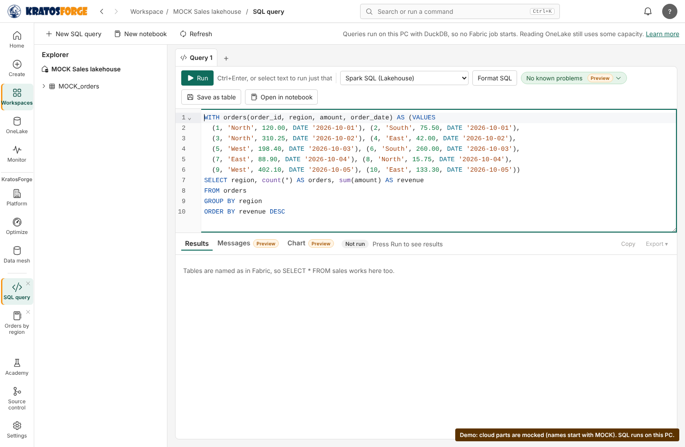
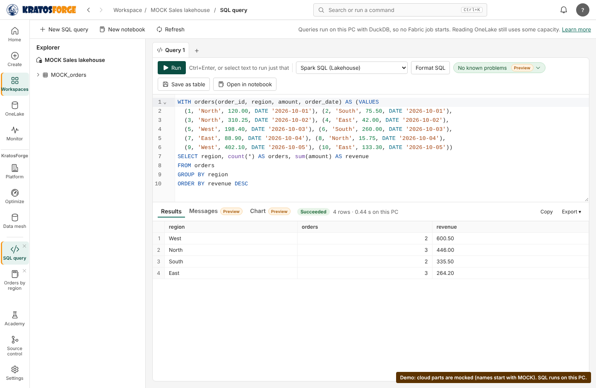
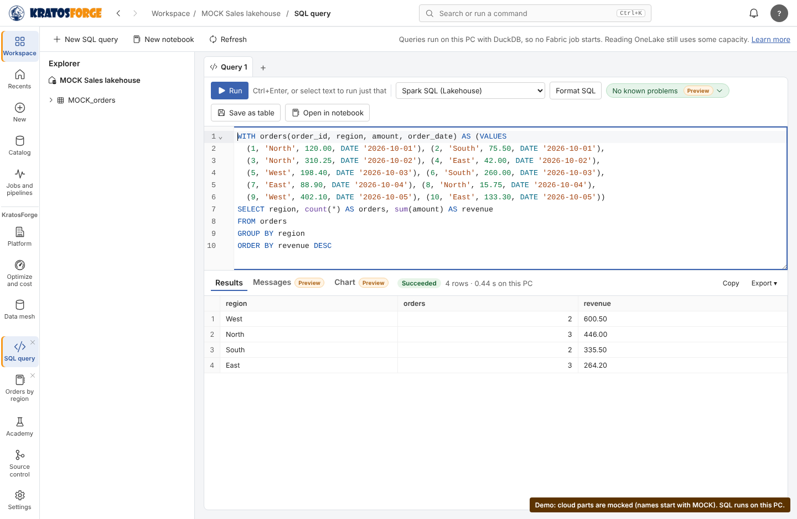
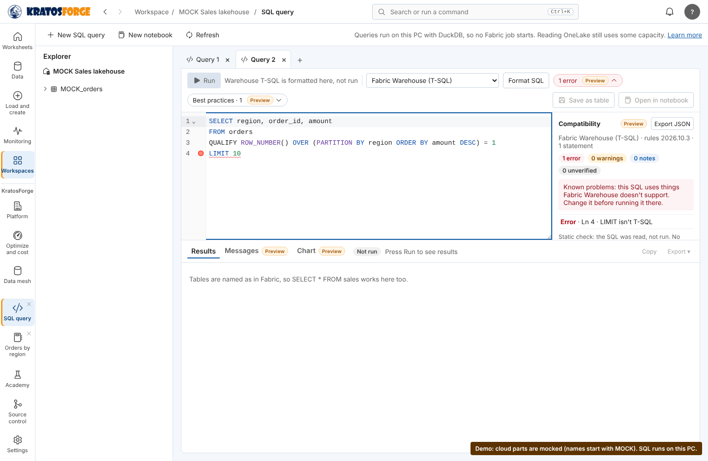
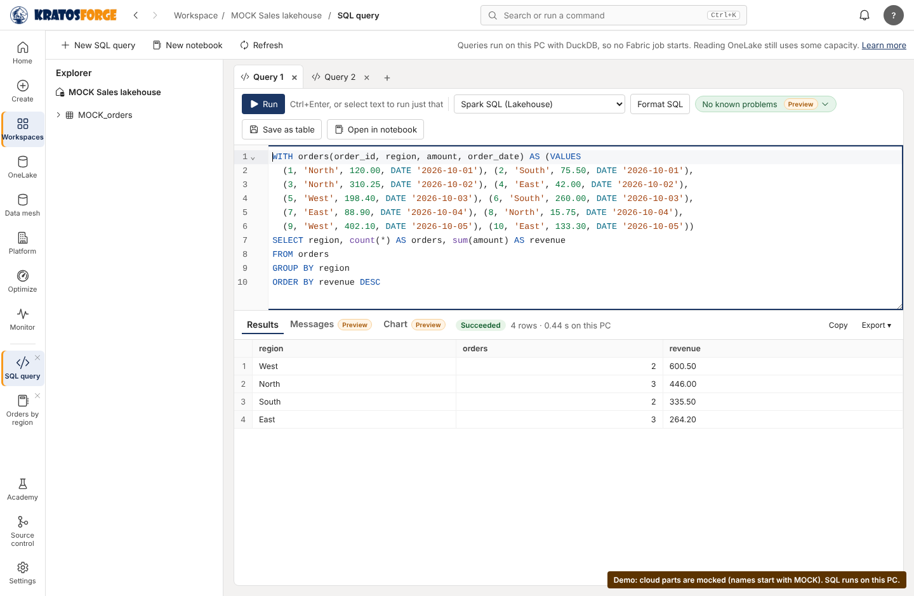
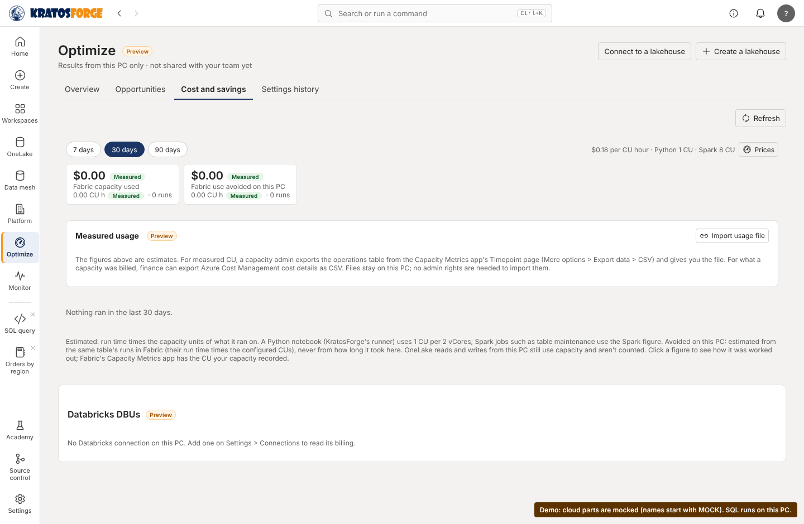

# Platform skins: the end-to-end demonstration

This page records the demonstration the skins brief asks for before a first release: one session that
goes through every skin and keeps its work. The cloud parts are **mocked**. Nothing signed in, and
nothing ran on Fabric, Databricks or Snowflake. This is a mocked demonstration, not a verified live
integration.

- **Script:** `app/tests/browser/skins-demo.test.cjs`. It is a browser test, so it runs with the other
  browser tests and keeps passing or fails like them.
- **Recorded:** 2026-11-05, on main at `a7631920`, in a Linux container with Chromium. It has not been
  run on Windows.
- **To record it again:**
  `DEMO_VIDEO_DIR=<folder> SCREENSHOT_DIR=<folder> NODE_PATH="$(npm root -g)" node --test app/tests/browser/skins-demo.test.cjs`

## What was real and what was mocked

| Part | Real or mocked |
| --- | --- |
| Skins, Settings, saving the chosen skin | Real engine (`app_settings`, `save_app_settings`, `skins_list`) |
| Running SQL | Real engine, DuckDB on this PC (`sql_start`, `sql_status`, `sql_page`) |
| SQL compatibility and best-practice checks | Real engine (`sql_analyze`, `sql_practices`) |
| Optimize > Cost and savings | Real engine (`cost_report`, `optimize_status`) |
| The lakehouse the SQL page points at, and its table list | **Mocked**: "MOCK Sales lakehouse", "MOCK_orders" |
| Sign-in, Fabric, Databricks, Snowflake | Not used |

Every mocked name starts with MOCK. A label in the corner of the window says
"Demo: cloud parts are mocked" for the whole recording. The test data is 10 orders written inline in
the query (`VALUES`), so the run needs no files.

## The steps and what each showed

| Step | What the test checks | Screenshot |
| --- | --- | --- |
| 1. Open a project in the Fabric skin | The rail is in the Fabric-familiar order. A notebook is open with an edit not yet saved, and a SQL tab is on the mocked lakehouse. |  |
| 2. Run supported SQL on this PC | The run succeeds with "4 rows · … s on this PC", giving West 600.50, North 446.00, South 335.50 and East 264.20. |  |
| 3. Switch to the Databricks skin | The notebook, its unsaved edit and the SQL tabs are unchanged. The same 4 rows show without running again. |  |
| 4. Switch to the Snowflake skin and check compatibility | State is kept. A query written the Snowflake way (QUALIFY, LIMIT), checked against Fabric Warehouse, is marked "Known problems" with "LIMIT isn't T-SQL" underlined. |  |
| 5. Return to KratosForge and review | The skin's colors are gone and the first tab still holds the step 2 result. Optimize > Cost and savings shows what this PC avoided. Through all of it, no sign-in, engine-session or workspace call was made. |   |

The test also checks that the page threw no errors during the whole session.

## Limitations found

These were seen in this run or read in the code. None is fixed by this page.

1. **Snowflake isn't a target on the SQL page.** The page checks SQL against the Fabric engines and DuckDB
   only, so step 4 checks Snowflake-style SQL against Fabric Warehouse, not as Snowflake SQL. The engine
   already has a Snowflake portability report (`sql_portability.py`), but no screen calls it.
2. **Fabric Warehouse wasn't warned about QUALIFY.** In step 4, `sql_analyze` reported only LIMIT for the
   query above. QUALIFY isn't T-SQL. This was seen, not traced; the SQL rules owner should check it.
3. **The portability report's Spark rewrite of QUALIFY with LIMIT changes the order.** Run directly in the
   engine, `sql_portability.portability(<the query above>, "snowflake")` rewrote it for Spark with
   `LIMIT 10` inside the subquery, before the `ROW_NUMBER() = 1` filter. It graded that "translated", with
   no reason given. Applying the limit first can return different rows. This was seen in the engine's
   output, not in the app.
4. **A notebook can't run Snowflake SQL cells.** The DuckDB engine can translate Snowflake SQL
   (`engines/local_sql.py`), but the notebook only ever asks for Spark SQL (`%%sql`) or Python
   (`engines_service.cell_request`). This was read in the code.
5. **Cost and savings doesn't count SQL page runs.** It showed 0 runs after step 2. The SQL page's runs on
   this PC aren't part of its figures.
6. **"An existing project" is an open notebook and a SQL tab on a mocked lakehouse.** It is not a project
   folder opened from disk.

The recording (MP4, 22 seconds) and the screenshots are kept with the project's files, under
`skins/demo/2026-11-05/`.
