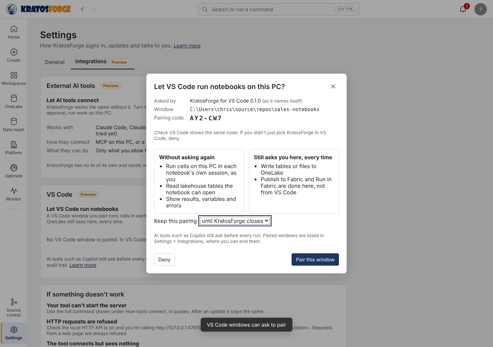

# VS Code and KratosForge (Preview)

Use VS Code and KratosForge together on the same notebooks. Notebooks are plain `.ipynb` files, so VS Code opens them as they are, and KratosForge keeps running them on this PC, side by side with Fabric, and publishing them.

| You want to | Where |
| --- | --- |
| Open a notebook, or its folder, in VS Code | The notebook's **Home** tab: **Open in VS Code** |
| Let Copilot in VS Code use KratosForge | **Settings › Integrations › Add a tool**, pick VS Code, then **Add to VS Code** ([Connect your AI tool](ai/README.md)) |
| Keep edits from both editors | Nothing to do: see [Editing in both](#editing-in-both) |
| Get a repository ready for everyone who opens it in VS Code | **Source control**, a notebooks repository: **Set up for VS Code** ([Set up a repository](#set-up-a-repository-for-vs-code)) |
| Check a notebook from VS Code without running it | The **KratosForge: Validate notebook** task, or `kratosforge nb validate` ([Validate from VS Code](#validate-from-vs-code)) |
| Jump from VS Code back to the notebook in KratosForge | The **KratosForge: Open notebook in KratosForge** task, or a `kratosforge://` link ([Links into KratosForge](#links-into-kratosforge)) |

## Open in VS Code

On a notebook's **Home** tab, **Open in VS Code** saves the notebook and opens its file in VS Code. The arrow beside it has:

- **Open the repository folder in VS Code**, for a notebook in a notebooks repository (Source control), or **Open the notebooks folder in VS Code** for the app's own folder;
- **Open this notebook in VS Code Insiders**.

VS Code has to be installed. KratosForge asks Windows to open a `vscode://file/…` link, which VS Code handles; only a notebook file, or a folder, in the notebooks folder or a repository opened in Source control is opened this way.

## Editing in both

When you come back to KratosForge and the open notebook has no unsaved edits here, it shows the file as VS Code saved it. Cells whose code didn't change keep their outputs, because the session that made them is still running.

When both sides have changes, KratosForge doesn't save over the other one: it asks **Keep mine** or **Load its version**, and keeps both under **Versions**. See [Edit the same notebook in VS Code or another program](notebook-files.md#edit-the-same-notebook-in-vs-code-or-another-program).

## Set up a repository for VS Code

On the **Source control** page, a notebooks repository has **Set up for VS Code** in its header. A notebook in that repository also has it in the arrow beside **Open in VS Code**. It lists the files it would add, and adds the ones you tick:

| File | What it does |
| --- | --- |
| `.vscode/tasks.json` | Two tasks (**Terminal › Run Task**): **KratosForge: Validate notebook**, which lists what it finds in VS Code's **Problems** panel, and **KratosForge: Open notebook in KratosForge**. |
| `.vscode/mcp.json` | Connects Copilot agent mode to KratosForge's MCP server. VS Code asks each developer for their own connection id (from **Settings › Integrations**), so no id is written in the file. |
| `.vscode/extensions.json` | Suggests the Jupyter, Python and Copilot Chat extensions to anyone who opens the repository. |
| `.github/copilot-instructions.md` | Tells Copilot how to use KratosForge's tools and approvals: the [instructions for your AI tool](ai/agent-instructions.md), plus a line on the Validate task. |

A file that's already in the repository is never replaced: it shows as **Already there**, and for Copilot's instructions you can copy the text to add yourself. Nothing is committed or pushed; the new files show under **Changes** for you to review and commit. Nothing in Fabric, OneLake or VS Code's own settings changes.

## Validate from VS Code

The Validate task runs `kratosforge nb validate` on the open notebook. It's the same code check as **Validate** in KratosForge (without the clean run): names used before they're defined, what stops it running on this PC or in Fabric, missing packages, secrets in the code, side effects and parameters. It reads the notebook file and runs nothing.

You can also run it in a terminal:

```
kratosforge nb validate "notebooks\Daily sales.ipynb" [--runs-on pc|fabric] [--json]
```

- Each finding is one line, `file:1:1: severity: message`. The message names the cell, because an `.ipynb` has no line per cell, so VS Code lists the finding against the notebook as a whole.
- **--runs-on** says where the notebook will run. Without it, the notebook's own **Runs on** is used. If that isn't set, anything that stops it running in one place or the other is a warning.
- **--path-from-env NAME** reads the file's path from an environment variable instead. The task uses it (`KRATOSFORGE_FILE`), so no shell reads the notebook's name: a name with `&` or other characters a command line treats specially can't run anything.
- It exits with 1 when there are errors, and 2 when the file isn't a notebook.
- `kratosforge` is `%LOCALAPPDATA%\FabricDesktop\bin\kratosforge.cmd`. KratosForge writes it each time the app starts, pointing at the current engine.

## Links into KratosForge

A `kratosforge://` link shows a notebook or a page in KratosForge, from VS Code, a terminal, a browser or a document:

| Link | Shows |
| --- | --- |
| `kratosforge://notebook?path=<file>` | The notebook saved in that `.ipynb` file. The path has to be a full path on a drive of this PC, such as `C:\Users\…\Daily.ipynb`, in the app's notebooks folder or a notebooks repository opened in Source control. A network path (`\\server\share\…`) is refused before anything reads it, and so is a path through a link or junction inside those folders. |
| `kratosforge://notebook?name=Sales%2FDaily%20load` | The notebook with that name. |
| `kratosforge://page/<page>` | A page from the left rail, such as `kratosforge://page/monitor`. |
| `kratosforge://` | Brings the open window to the front. |

- If KratosForge is open, the link goes to that window and brings it to the front. If it isn't open, the link starts it. Only one copy of KratosForge runs at a time; starting it again brings the open window forward.
- A link only shows something. Nothing in it runs, publishes or changes anything. Unsaved edits in the open notebook are saved first, as when you open another notebook yourself. A link that isn't one of the forms above opens nothing: KratosForge only says it didn't open the link, and why.
- `kratosforge nb open <file>` opens the link for a file, and `--print` prints it instead. The **Open notebook in KratosForge** task runs this command.
- KratosForge registers `kratosforge://` for your Windows user (under `HKCU\Software\Classes`) each time it starts. Your organization can turn that off with `register_link_scheme` in its policy file ([the key](azure-setup.md#4-push-settings-to-everyone)).
- A copy started for a link hands it to the open window over `127.0.0.1`, with a random token the open window wrote to your own data folder, and then closes. Without the token, nothing is shown.

## What runs where

Opening a notebook in VS Code doesn't run anything. Cells you run in VS Code use whatever kernel you pick there. With a paired window (below), they run in KratosForge's session for that notebook on this PC.

## Run cells from VS Code

Preview. The KratosForge extension for VS Code, which picks this up in VS Code's kernel picker, is on its way; this is the app's side of it.

1. In **Settings > Integrations > VS Code**, turn on **Let VS Code run notebooks**. It's off until you do, and your organization can keep it off (`integrations_editors` in the [policy file](azure-setup.md#4-push-settings-to-everyone)).
2. In VS Code, pick KratosForge as the notebook's kernel. KratosForge asks **Let VS Code run notebooks on this PC?** with the window's folder and a pairing code. Check VS Code shows the same code, choose how long to keep the pairing, and **Pair this window**.


3. Cells you run in that window run in the notebook's own session here: the same variables, `spark`, default lakehouse and limits as running them in KratosForge. Stop in VS Code stops the cell.

What a paired window can and can't do:

| Without asking again | Still asks in KratosForge, every time |
| --- | --- |
| Run cells of notebooks in the app's notebooks folder or a notebooks repository opened in Source control | Write a table or file to OneLake: **Allow once** covers that table for the rest of the cell; nobody answering in 5 minutes means no |
| Read the tables the notebook's lakehouse has | Publish, Run in Fabric and Side by side are done in KratosForge, not from VS Code |
| See the cell's output and the notebook's variables | |

- A pairing lasts until KratosForge closes (kept in memory only), 8 hours or 7 days, as you choose. Settings lists paired windows; **End** stops one at once, and turning the switch off ends them all.
- Every run, Stop, pairing and OneLake answer is in the [audit trail](user-guide.md#audit-trail).
- AI tools such as Copilot never pair: they keep asking before every run ([External AI tools](user-guide.md#external-ai-tools)).
- The OneLake question is a check on KratosForge's own write paths, not a sandbox: a cell runs as you, as your own cells here do.

How it connects: while the switch is on, the engine listens on `127.0.0.1` on a port it picks, and writes the port with a random value (the "hello") to `editor-port` in your data folder (`%LOCALAPPDATA%\FabricDesktop`). Asking to pair needs the hello, so only programs that can read your data folder can ask, and you still have to say yes. A paired window sends a token with every call; only a hash of the token is kept. Requests from a web page, or with a `Host` that isn't this PC's loopback address, are refused.

## What it reads and writes

| Action | Reads | Writes |
| --- | --- | --- |
| Open in VS Code | Where the notebook's file is | The notebook, saved first (as **Save**) |
| Coming back into focus | The notebook's file, to see if its cells changed | Nothing |
| Set up for VS Code | Which of its files the repository already has | The files you tick, only if they're not there yet |
| Validate task, `kratosforge nb validate` | The notebook file, and the package versions Fabric runs reported | Nothing |
| A `kratosforge://` link, `kratosforge nb open` | Which notebook the file is | Unsaved edits in the open notebook, saved first (as **Save**) |
| Let VS Code run notebooks | Nothing | `editor-port` while it's on; `editor\settings.json` |
| Pairing a window | The window's folder and name, as it sends them | `editor\pairings.json` (a hash of the token) for 8-hour and 7-day pairings |
| A cell run from a paired window | What the cell reads | What the cell writes on this PC; OneLake only after you allow it |
